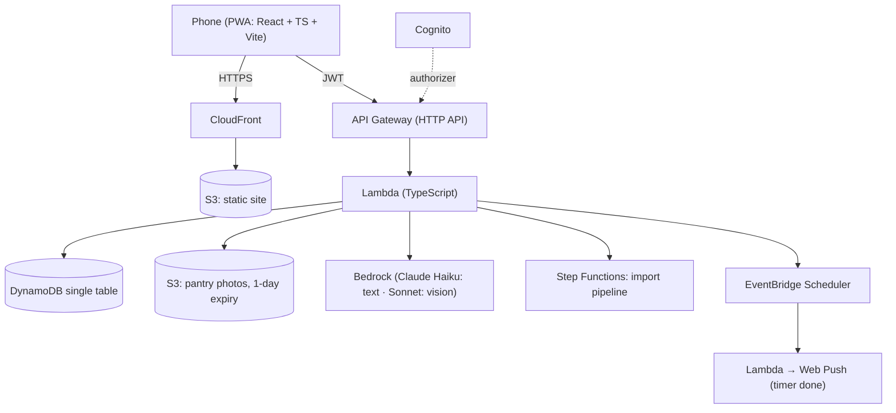

# Simmer

A free, household-first cooking web app. Import a recipe from a website or a TikTok/Instagram
caption, cook it one step at a time with named timers, photograph the fridge to see what you
already have, and get a grocery list for the rest.

It is also a hands-on AWS project: serverless backend, Terraform for everything, and CI/CD with
GitHub Actions over OIDC (no stored AWS keys).

> **Status:** Phase 0 (foundations). Nothing is deployed yet.

## Architecture



## Repo layout

| Path | What's in it |
|---|---|
| `web/` | The PWA (Vite + React + TypeScript) |
| `api/` | Lambda handlers (TypeScript) |
| `infra/` | Terraform: budget alarm today; the rest of the stack as phases land |
| `docs/adr/` | Architecture decision records |
| `scripts/check-privacy.mjs` | Blocks commits containing secrets or personal data (pre-commit + CI) |

## Develop

```sh
npm install          # also points git at .githooks/
npm run dev -w web   # http://localhost:5173
npm test             # privacy check + web and api tests
npm run lint
npm run typecheck
```

Terraform (local check, no AWS credentials needed):

```sh
cd infra
terraform init -backend=false
terraform validate
```

## Cost guardrails

- AWS Budgets alarm at $5/month (`infra/budget.tf`).
- Claude Haiku for all text parsing; Sonnet only for photos. Parsed recipes are cached by URL.
- Per-household daily caps on imports and photo scans.
- Pantry photos are deleted after one day.

## Decisions

- [ADR-001: PWA over native](docs/adr/001-pwa-over-native.md)
- [ADR-002: Captions-only reel import](docs/adr/002-captions-only-reel-import.md)

## License

MIT
